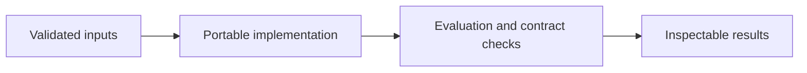

# Weather and Review Data Warehouse

**Feras Elghandour** · Technical case study

Join review activity with daily weather observations through explicit staging, operational, and analytical data layers.

## Implementation

A portable four-dimension review warehouse, station-and-date weather joins, data coverage counts, and monthly reporting views.



## Completed study

The analytical core has four dimensions and one review fact table. Its joins preserve station identity and report weather-coverage counts. In-memory SQLite checks exercise the schema, geographic join, and reporting views.

These historical figures describe the completed study. This refactored standalone implementation has separate validation and has not been used to recertify the historical benchmark. The public release contains the portable core and focused tests.

## Run locally

Python 3.11 or later.

```sh
python -m venv .venv
source .venv/bin/activate
python -m pip install -r requirements.txt
python smoke_test.py
python smoke_test.py
```

Prepare your own inputs as described in [DATA.md](DATA.md). Tests use generated fixtures and do not need credentials or provider calls. [VALIDATION.md](VALIDATION.md) records their scope.

## Practical relevance and limitations

Joining by date requires that reviews and weather refer to the same station region; apply a geographic restriction before interpretation. Weather–rating correlations do not establish causation. No live Snowflake run or warehouse scale benchmark is claimed.

This edition makes the core behavior reusable and inspectable. Historical metrics and synthetic contract tests provide different kinds of evidence; neither establishes client deployment or commercial impact.
