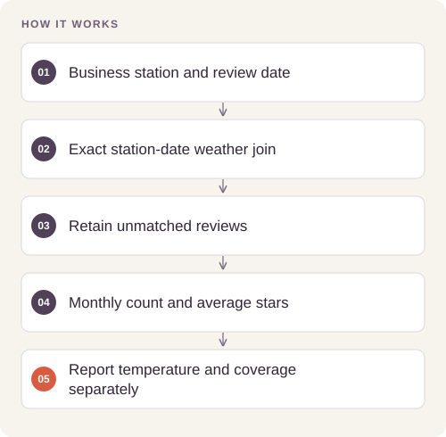

# Weather and Review Data Warehouse

Join review activity with daily weather observations while preserving geographic context and measuring data coverage.

## Implementation

A portable four-dimension review warehouse, station-and-date weather joins, data coverage counts, and monthly reporting views.




## Reproduce and inspect

The executable reproduction profile now records exact commands, input/source hashes, dependency versions, logs and pass/fail status. Its scope distinguishes behavior checks from full-data benchmarks.

[Commands, artifacts and benchmark scope](BENCHMARKS.md) · [Versioned profiles](reproduction.json)


## Try a small example

A small offline fixture exercises the public implementation. It demonstrates the behavior shown below; it does not replace the historical dataset, benchmark or production validation.

After the local setup below, run from the repository root:

```sh
python examples/quickstart.py
```

The [example source](examples/quickstart.py), [captured output](examples/expected-output.txt) and [execution record](examples/environment.json) keep this demonstration inspectable. Floating-point values may vary with library versions.

Observed output from this run:

```text
{
  "matched_max_temperature_f": 80.0,
  "monthly_summary": [
    1,
    4.0,
    1
  ]
}
```

## Completed study

The analytical core has four dimensions and one review fact table. Its joins preserve station identity and report weather-coverage counts. In-memory SQLite checks exercise the schema, geographic join, and reporting views.

These historical figures describe the completed study. This refactored standalone implementation has separate validation and has not been used to recertify the historical benchmark. The public release contains the portable core and focused tests.

## Run locally

Python 3.11 or later.

```sh
python -m venv .venv
source .venv/bin/activate
python -m pip install -r requirements.txt
python smoke_test.py
```

Prepare your own inputs as described in [DATA.md](DATA.md). Tests use generated fixtures and do not need credentials or provider calls. [VALIDATION.md](VALIDATION.md) records their scope.

## Practical relevance and limitations

Joining by date requires that reviews and weather refer to the same station region; apply a geographic restriction before interpretation. Weather–rating correlations do not establish causation. No live Snowflake run or warehouse scale benchmark is claimed.
